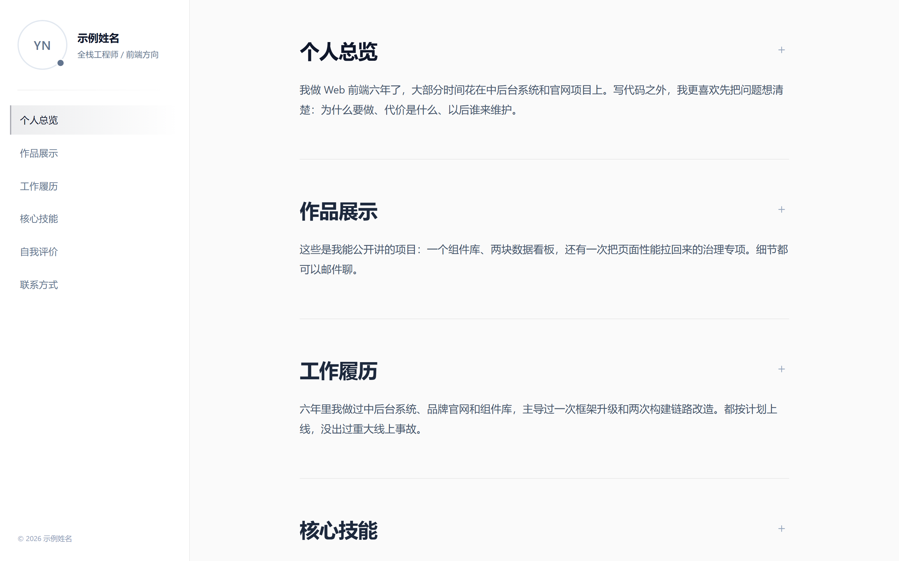
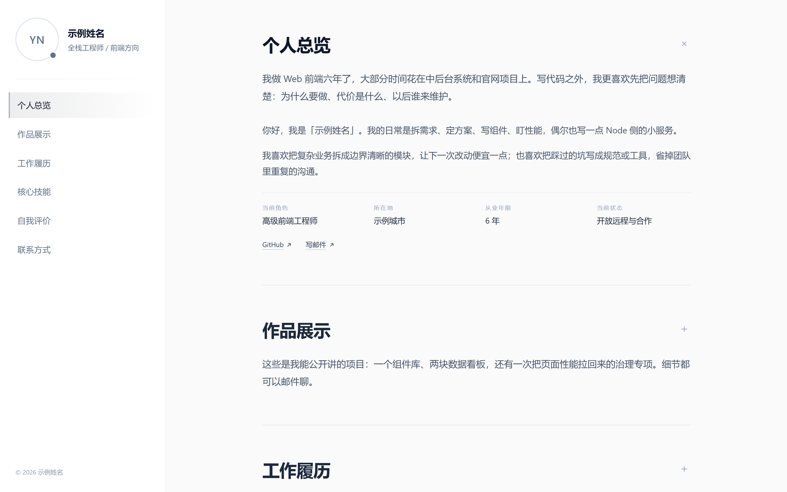
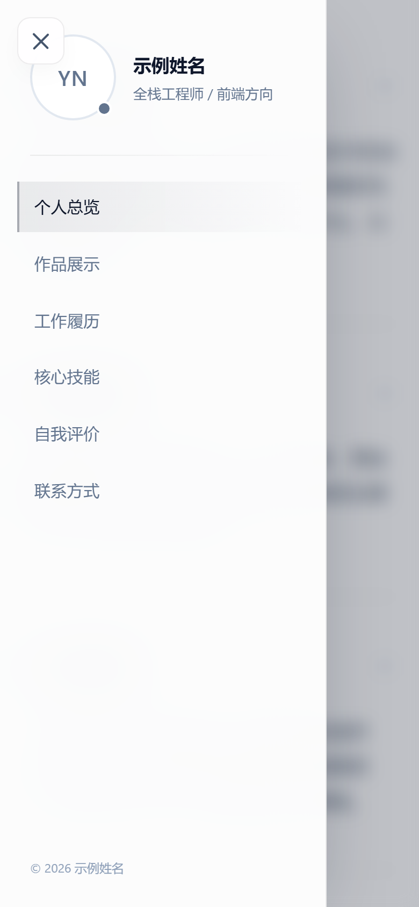
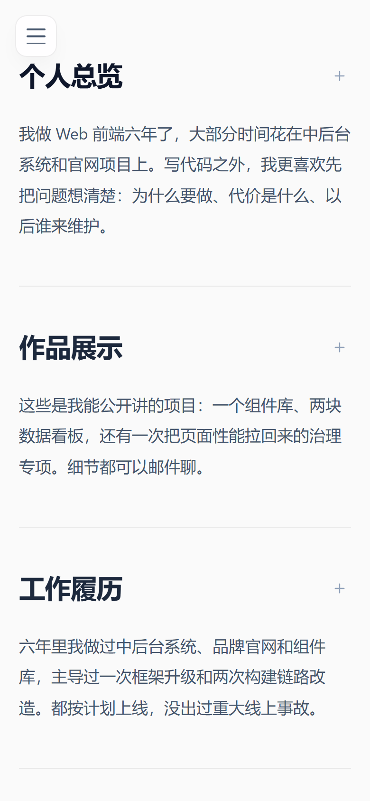
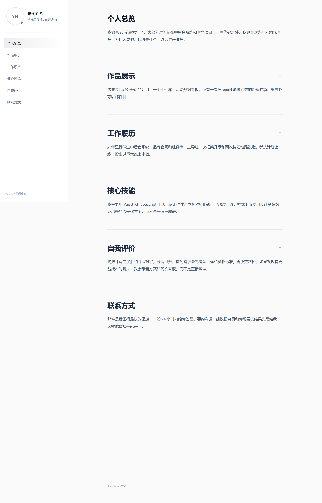

# 个人网站

单页个人作品集站点：左侧是照片与垂直导航，右侧按板块纵向排布内容；滚动时导航自动跟随高亮，板块可展开查看细节，窄屏自动降级为抽屉式菜单。

基于 **Vue 3 + Vite + Tailwind CSS v4**，无路由、无状态管理库、无 UI 组件库，全部交互自行实现。



---

## 特性

- **左右分栏**：左侧固定 19rem 导航栏吸附视口，右侧内容区随窗口自适应伸缩
- **滚动联动高亮**：以贴近视口顶部的判定线定位当前板块，导航高亮块平滑滑动跟随，交界处不抖动、不闪烁
- **两段式导航点击**：点击未选中的标题 → 滚动定位；再次点击当前标题 → 展开/收起该板块
- **板块折叠**：`grid-template-rows: 0fr → 1fr` 过渡，高度由内容决定，无需测量也不会跳变
- **整块可点击**：板块任意空白处均可切换展开；链接、按钮、表单控件与文字选区内不触发
- **响应式降级**：宽度不足或比例不理想时侧栏不渲染，左上角出现汉堡按钮，抽屉可经导航项 / 遮罩 / Esc / 再次点击按钮四种方式收起
- **无障碍**：`aria-expanded`、`aria-controls`、`aria-current`、`role="dialog"`、焦点转移与归还、`body` 滚动锁、`inert` 隔离收起内容、`:focus-visible` 描边
- **零配置主题**：所有颜色、字体、缓动集中在 `style.css` 的 `@theme` 中，改令牌即可换肤

---

## 截图

### 板块展开态

点击板块标题右侧的加号（或再次点击侧栏对应标题），展开该板块的详细内容，图标旋转 45° 变为关闭态。



### 窄屏：抽屉导航

视口宽度小于 900px 或纵横比不理想时，侧栏整体不渲染，左上角出现汉堡按钮。抽屉从左滑入，背景模糊遮罩，展开后按钮图标变为关闭态。



### 窄屏：内容满宽

导航收起后主内容区占满可用宽度，锚点滚动自动补偿顶部悬浮按钮的高度。



<details>
<summary>展开查看全页缩略图</summary>



</details>

---

## 技术栈

| 类别 | 选型 | 说明 |
|---|---|---|
| 框架 | Vue 3.5（Composition API，`<script setup>`） | 组件全部为单文件组件 |
| 构建 | Vite 8.3 | 开发热更新、生产打包 |
| 样式 | Tailwind CSS 4.3（`@tailwindcss/vite`） | v4 方案，无 `tailwind.config.js`，令牌写在 CSS 的 `@theme` 中 |
| 语言 | JavaScript | 未启用 TypeScript |
| 运行时依赖 | 仅 `vue` | 无路由、无状态库、无组件库 |

---

## 快速开始

```bash
npm install      # 安装依赖
npm run dev      # 启动开发服务器（默认 http://localhost:5173）
npm run build    # 生产构建，输出到 dist/
npm run preview  # 本地预览构建产物
```

> 若浏览器无法打开，请用 `localhost` 而非 `127.0.0.1`——开发服务器在部分 Windows 环境下只绑定 IPv6 回环地址。

---

## 目录结构

```
.
├─ docs/screenshots/            README 配图
├─ index.html                   入口 HTML（含首屏防白闪的内联背景色）
├─ vite.config.js               Vite + Vue + Tailwind 插件
├─ src/
│  ├─ layouts/
│  │  └─ PageLayout.vue         布局层：分栏网格、滚动联动编排、抽屉挂载
│  ├─ components/
│  │  ├─ Sidebar.vue            导航层：照片、姓名、垂直导航、滑动高亮块
│  │  ├─ MobileMenuButton.vue   导航层：汉堡按钮（三线变叉、aria 状态）
│  │  ├─ SectionShell.vue       板块容器层：标题、摘要、展开按钮、折叠动画
│  │  └─ sections/
│  │     ├─ index.js            板块 id → 视图组件映射
│  │     ├─ Overview.vue        个人总览
│  │     ├─ Works.vue           作品展示
│  │     ├─ Experience.vue      工作履历（含社会时间线切换）
│  │     ├─ Skills.vue          核心技能
│  │     ├─ About.vue           自我评价
│  │     └─ Contact.vue         联系方式
│  ├─ content/
│  │  ├─ index.js               板块注册表（数组顺序 = 导航顺序）、站点元信息
│  │  ├─ overview.js            每个板块的文案与数据独立成文件
│  │  ├─ works.js
│  │  ├─ experience.js
│  │  ├─ skills.js
│  │  ├─ about.js
│  │  └─ contact.js
│  ├─ composables/
│  │  ├─ useActiveSection.js    滚动联动：判定线计算、高亮锁定、触底兜底
│  │  ├─ useNavigation.js       导航状态机：选中 / 展开
│  │  ├─ useDrawer.js           抽屉副作用：滚动锁、焦点转移、Esc
│  │  └─ useMediaQuery.js       媒体查询订阅
│  ├─ App.vue                   仅挂载布局层
│  ├─ main.js                   应用入口
│  └─ style.css                 Tailwind 入口 + 设计令牌 + 基础层
└─ package.json
```

**分层约定**：`layouts/` 负责页面结构，`components/` 负责视图与交互，`content/` 只存放数据，`composables/` 存放可复用的状态逻辑。板块内容与视图组件通过 id 解耦，新增板块不需要改动布局层。

---

## 功能与实现分布

| 需求 | 实现位置 | 关键做法 |
|---|---|---|
| 左右分栏 | `PageLayout.vue` | `grid-cols-[19rem_minmax(0,1fr)]`，`minmax(0,1fr)` 防止内容撑破列宽 |
| 侧栏吸附 | `PageLayout.vue` | `aside` 使用 `sticky top-0 h-dvh self-start` |
| 滚动高亮 | `useActiveSection.js` | 单条判定线 + 「最后一个顶部越过判定线的板块」，`requestAnimationFrame` 节流 |
| 高亮跟随动画 | `Sidebar.vue` | 整站只渲染一个高亮块，按选中项的 `offsetTop` / `offsetHeight` 做 `translateY` 位移 |
| 点击定位 | `useNavigation.js` | `scrollIntoView({ behavior: 'smooth' })`，同时 `lockTo` 锁定目标高亮 |
| 再次点击展开 | `useNavigation.js` | `activateSection` 内比较 `activeId`，相同则调用 `toggleExpanded` |
| 板块折叠 | `SectionShell.vue` | `grid-template-rows` 在 `0fr` / `1fr` 间过渡，420ms |
| 整块切换 | `SectionShell.vue` | 冒泡点击 + `closest()` 排除交互元素，选字时跳过 |
| 窄屏判定 | `useMediaQuery.js` | `(min-width: 900px) and (min-aspect-ratio: 1/1)` |
| 抽屉容器 | `PageLayout.vue` | `Teleport` 到 body + `<Transition>`，遮罩与面板各自过渡 |
| 抽屉副作用 | `useDrawer.js` | `watch` 开关状态：加/去 `is-scroll-locked`、打开时聚焦面板、关闭时焦点归还按钮 |
| Esc 关闭 | `useDrawer.js` | 文档级 `keydown` 监听，仅打开时响应 |
| 抽屉内点选 | `useNavigation.js` | `activateFromDrawer` 先定位或展开，再收起抽屉 |

---

## 关键实现说明

### 1. 滚动联动：为什么不用 IntersectionObserver

滚动高亮的常见问题是高亮与实际视觉焦点错位，或交界处来回闪烁。这里用单条判定线：

```js
const line = Math.min(window.innerHeight * 0.16, 160)
for (const id of ids) {
  if (document.getElementById(id).getBoundingClientRect().top <= line) current = id
}
```

- **只取一条线**：板块交界处只会产生一次切换，不会出现双阈值方案那种「两块同时满足」的抖动
- **加上 160px 上限**：纯比例在大屏上会把判定线推到第二个板块顶部，造成「顶部显示第一块却高亮第二块」
- **贴顶短路**：`scrollY <= 4` 时直接锁定第一板块
- **触底兜底**：滚到底时强制高亮最后一块，避免最后一屏高度不足永远无法选中
- **程序化滚动锁定**：`lockTo(id)` 在平滑滚动期间固定高亮，避免高亮依次掠过中间板块

同时最后一块被赋予 `min-h-[calc(100dvh_-_4.5rem)]`，保证「它的上边界贴到视口顶部」恰好等于「页面滚到底」，高亮可以完整走到最后一项。

### 2. 折叠为什么用 `0fr → 1fr`

`max-height` 方案需要预设高度或读取 `scrollHeight`，内容变化后会露出空隙或提前截断。`grid-template-rows` 从 `0fr` 过渡到 `1fr`，高度由子元素自然撑开：

```html
<div class="grid transition-[grid-template-rows] duration-[420ms]"
     :style="{ gridTemplateRows: expanded ? '1fr' : '0fr' }">
  <div class="overflow-hidden">…</div>
</div>
```

收起时内容区加 `inert`，避免键盘焦点进入不可见区域。

### 3. 导航点击的两段式行为

```js
function activateSection(id) {
  if (activeId.value !== id) {
    scrollToSection(id)   // 首次点击：定位并选中
    return
  }
  toggleExpanded(id)      // 再次点击：切换展开
}
```

侧栏与板块内的加号互不干扰：加号始终只做 `toggle`，不触发滚动。

### 4. 响应式降级

判断条件是**宽度与纵横比同时满足**：

```js
const isWide = useMediaQuery('(min-width: 900px) and (min-aspect-ratio: 1 / 1)')
```

因此平板竖屏（如 1024×1366）、超宽窗口压扁高度、分屏窄窗都会降级——这些场景下左右分栏会把右侧内容挤得过窄。

侧栏用 `v-if` 而非 CSS 隐藏，降级时完全不渲染、不占宽度；抽屉通过 `Teleport` 挂到 `body`，不受父级层叠与溢出影响。

### 5. 可访问性

- 汉堡按钮：`aria-expanded`、`aria-controls="site-drawer"`、随状态变化的 `aria-label`
- 抽屉面板：`role="dialog"`、`aria-modal="true"`、`tabindex="-1"`，打开后接收焦点，关闭时归还给按钮
- 导航项：`aria-current` 标记当前板块，`aria-expanded` / `aria-controls` 关联详细内容面板
- 展开按钮：`aria-label` 说明「展开/收起某某板块的详细内容」
- 焦点环：全局 `:focus-visible` 统一描边，不使用 `outline: none`
- 动效：`prefers-reduced-motion: reduce` 时关闭关键帧与平滑动效

---

## 设计规范

整体为**灰白单色、无卡片、线条分隔**的编辑式排版。

| 令牌 | 值 | 用途 |
|---|---|---|
| `ink-950` | `#ffffff` | 侧栏、抽屉底色 |
| `ink-900` | `#fafafa` | 页面底色 |
| `ink-800` | `#f4f4f5` | 次级面 |
| `line` | `rgba(24,24,27,.08)` | 分隔线 |
| `line-strong` | `rgba(24,24,27,.18)` | 激活态边线 |
| `accent-400 / 500` | `#52525b` / `#27272a` | 交互强调（退化灰阶，全站无彩色） |
| `--ease-soft` | `cubic-bezier(.22,1,.36,1)` | 统一缓动 |

排版参数：

- 内容栏宽 `max-w-[54rem]`（864px），侧栏 `19rem`（304px）
- 板块标题 28px → 32px（≥640px），行高 `1.08`，字距 `-0.03em`
- 摘要 17px / 行高 `1.9`，正文 16px 左右
- 板块以 `border-t` 分隔，首个板块不画线；无圆角块、无阴影、无内容底色

---

## 内容维护

### 修改已有板块

直接编辑 `src/content/<板块>.js`。例如个人信息集中在 `src/content/index.js`：

```js
export const profile = {
  name: '示例姓名',
  initials: 'YN',              // 侧栏头像占位字母
  role: '全栈工程师 / 前端方向',
}
```

> 当前所有文案均为**示例占位内容**，替换成真实资料即可。侧栏头像是首字母占位块，换真实照片需把 `Sidebar.vue` 里的圆形块改为 ``。

### 新增板块

三步，无需改动布局层：

1. 在 `src/content/` 新建数据文件，导出含 `id`、`title`、`summary` 的对象
2. 在 `src/content/index.js` 的 `sections` 数组登记（**顺序即导航顺序**）
3. 在 `src/components/sections/index.js` 的 `sectionComponents` 登记对应组件

第 2、3 步不一致时，开发环境控制台会给出警告，列出缺少组件的板块 id。

### 换主题

只改 `src/style.css` 的 `@theme` 即可，无需改动组件：

```css
@theme {
  --color-ink-900: #fafafa;     /* 页面底色 */
  --color-line: rgba(24, 24, 27, 0.08);
  --color-accent-400: #52525b;  /* 交互强调色 */
  --font-sans: "Inter", "PingFang SC", "Microsoft YaHei", sans-serif;
}
```

> 注意：组件内文字颜色使用的是 Tailwind 内置的 `slate` 色阶（如 `text-slate-600`），若要整体换成深色主题，除改令牌外还需反转这些色阶。

---

## 构建产物

```
dist/index.html                 0.76 kB │ gzip:  0.50 kB
dist/assets/index-*.css        32.60 kB │ gzip:  6.51 kB
dist/assets/index-*.js        104.34 kB │ gzip: 40.98 kB
```

共 37 个模块，构建耗时约 0.9s。运行时依赖只有 Vue 本身。

---

## 已验证环境

| 项目 | 结果 |
|---|---|
| 桌面端 1440×900 | 左右分栏、侧栏吸附、6 个板块正常渲染 |
| 平板竖屏 / 窄屏 390×844 | 侧栏不渲染、汉堡按钮出现、抽屉滑入与遮罩正常 |
| 板块展开 / 收起 | 动画平滑，布局无跳变，图标 45° 旋转 |
| 滚动高亮 | 逐板块滚动时高亮跟随，贴顶与触底两端均正确 |

---

## 说明

本项目内容为示例占位，样式与交互可按需修改。字体依赖系统已安装的 Inter，未内嵌字体文件；如需固定字形表现，可自行引入可变字体。
